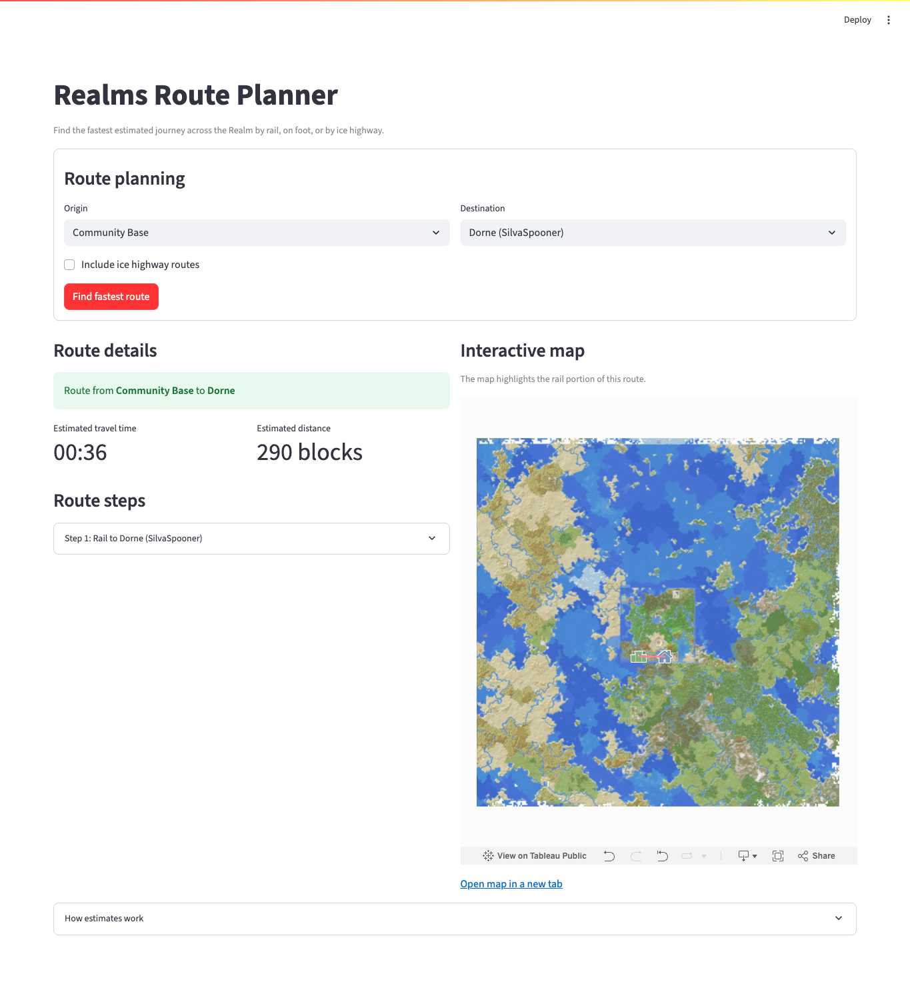

# Realms Route Planner

A route planner for a Minecraft Realm. It compares estimated travel times by rail, on foot, and optionally by ice highway, then shows the journey step by step. Rail routes can be highlighted on an embedded Tableau map.

[Open the app](https://realms-map-app.onrender.com/) · [View the Tableau map](https://public.tableau.com/views/WayfinderEmbed/Wayfinder)



## What it does

- Finds the fastest estimated route between named locations using Dijkstra's algorithm.
- Combines rail and walking, with an optional ice-highway network.
- Shows travel time, distance, individual legs, and walking coordinates.
- Filters the Tableau map to the route's rail segments. Walking and ice legs remain in the written directions.
- Swaps endpoints, copies directions, and shares a journey link with its ice-highway setting.
- Offers a five-step example from Community Base to Mob Farm, combining the existing rail network with a final walk.

## Using the route controls

Choose both locations and select **Find fastest route**. **Swap endpoints** reverses the current selections and calculates the return journey when both locations are selected. It keeps your ice-highway setting. **Try an example journey** selects Community Base to Mob Farm with ice disabled and calculates it immediately: rail through Central IHS, Fortune, Petrichor, and Galini, then a walk to the farm.

After a search, **Copy directions** opens the journey text, including coordinates and estimated times. Use the copy icon in its top-right corner, or select the text manually. **Share journey** offers a copyable link that restores both locations and the ice setting and calculates the route when opened. The browser address also reflects the last completed search, so it can be bookmarked. Copying and sharing refer to the displayed result, not unsubmitted form edits.

Links use the current app address and exact workbook location names, for example `?from=Community+Base&to=Mob+Farm&ice=0`. They recalculate using the workbook available when opened; they are not frozen route snapshots. A renamed or removed location produces a warning rather than a guessed substitute. Local-preview links stay local.

## Run locally

Use Python 3.11 or 3.12. From the repository root:

```sh
python -m venv .venv
source .venv/bin/activate
python -m pip install -r requirements.txt
python -m streamlit run main.py
```

On Windows, activate the environment with `.venv\Scripts\Activate.ps1` in PowerShell instead. The workbook is bundled with the repository; no API key or database is required. Loading the embedded map requires internet access to Tableau Public.

## How routes are estimated

The objective is **travel time**, not shortest distance. All calculations use the X/Z plane.

| Travel mode | Connections | Distance model | Assumed speed |
| --- | --- | --- | --- |
| Rail | Named links in the workbook | Manhattan distance: `abs(dx) + abs(dz)` | 8 blocks/second |
| Walking | Every pair of locations | Straight-line distance | 3 blocks/second |
| Ice highway | Every pair of ice stations, when enabled | Straight-line distance | 72 blocks/second |

These are the Realm's existing planning assumptions, not a terrain-aware simulation. The model does not account for elevation, obstacles, loading or waiting time, dimension changes, or measured track geometry. Enabling ice assumes direct travel between every pair of ice stations. Times are estimates, displayed as minutes and seconds with fractional seconds omitted.

The graph includes all locations, including those without a rail connection. The search keeps the best known travel time to each location and reconstructs the selected route from predecessor edges. Locations retain their identities even if they have the same coordinates.

## Update Realm data

The Python application's source is **`Realms Map Dataset.xlsx`**, sheet **`Tableau Data`**. Keep that filename and sheet name unless updating the loader too.

| Column | Meaning |
| --- | --- |
| `Location` | Location name and identifier; names must be nonblank |
| `X`, `Z` | Finite numeric coordinates |
| `Path` | Rail link name, or blank for a location without a link |
| `Type` | Optional category; values containing `Ice Highway` identify ice stations |
| `Owner` | Optional display metadata |

Each named rail path needs exactly two rows describing two distinct locations. A location may appear in multiple paths, but its coordinates and metadata must agree across rows. Leading and trailing whitespace is removed on load; parentheses and other meaningful characters are preserved. Malformed input produces a validation error rather than silently dropping a rail connection.

After editing the workbook, run the tests below and verify representative routes. The app invalidates its data cache and previous route result when the workbook contents change. Updating this repository does **not** update the separately published Tableau workbook; keep its geography and path names aligned when changing the Realm network.

`archive/browser-prototype/realms_data.csv` belongs to the earlier browser prototype and is not read by the Python app. It is not automatically synchronized with the workbook.

The maintained Google Sheet is the authoring source; the bundled Excel file is the Python app's published export. Shared journeys pass the exact existing rail path names to Tableau, so publish the same approved data to both consumers.

### Google Sheets editor and publishing

The optional [Sheets sidebar](apps-script/README.md) adds and edits locations and manages Overworld rail connections inside the **existing Google spreadsheet**. Location edits update repeated map rows and matching land-claim labels/details. Rail removals preserve their endpoint places; location deletion and world moves are guarded against attached links or claims. Reviewed edits preserve the spreadsheet URL, connected tabs, column headings, polygon geometry, and surviving path IDs. There is no public write endpoint and the Streamlit app receives no Google credentials.

Its publishing flow prepares a snapshot, asks you to verify Tableau's refresh, and approves that exact data for GitHub. The `Publish approved Sheet data` workflow validates and tests the Excel export before committing it. Owner setup is required; hourly polling is disabled unless the repository variable `SHEET_SYNC_ENABLED` is explicitly enabled. Installation, Google authentication, and the Tableau/Render deployment round must be verified before live use.

## Project layout

```text
main.py                    Streamlit interface and deployment entry point
realms/
  data.py                  Workbook loading and validation
  models.py                Locations, links, edges, and route records
  routing.py               Graph construction and fastest-route search
  journeys.py              Journey links and copyable directions
  tableau.py               Tableau URL and filter construction
tests/
  test_routing.py           Data, routing, and URL tests
  test_app.py               Streamlit interaction regressions
  test_journeys.py           Share-link validation and directions tests
Realms Map Dataset.xlsx     Maintained Python application data
requirements.txt           Runtime dependency versions
requirements-dev.txt       Runtime and development dependencies
requirements-sync.txt      Optional authenticated publishing dependencies
apps-script/               Bound Google Sheets sidebar and installation guide
tools/                     Approved-export sync and synthetic sidebar preview
pyproject.toml             Lint and formatting configuration
archive/browser-prototype/ Earlier HTML/JavaScript version and its CSV
```

The earlier browser prototype is preserved under `archive/browser-prototype/`. It is not used by the Render app and is not a supported alternative to the Python application. Its README records the differences and known limitations.

## Development checks

```sh
python -m pip install -r requirements-dev.txt
python -m unittest discover -s tests -v
python -m ruff check .
python -m ruff format --check .
```

The suite covers malformed data, exact location selection, walking and ice-only stations, colocated locations, missing inputs after a successful search, and clearing old map filters. It also covers swapping edited selections, the example journey, share-link round trips and validation, and keeping copied/shared details attached to the displayed result. An independent Bellman-Ford solver checks every source/destination pair in the bundled network with ice disabled and enabled. UI tests use Streamlit's AppTest; they do not contact Tableau, exercise the browser clipboard, or verify in-game terrain.

GitHub Actions is configured to run these checks on Python 3.11 and 3.12 for pull requests and changes to `main`. Runtime dependencies are pinned to the versions used by the existing application environment; this cleanup does not claim a dependency security audit or pin every transitive package.

## Render deployment

The Python entry point remains `main.py` and the data file remains at the repository root. For a Python web service, the commands are:

```sh
# Build
python -m pip install -r requirements.txt

# Start
python -m streamlit run main.py --server.address 0.0.0.0 --server.port "$PORT" --server.headless true
```

Use the Python version tested in CI. Confirm the existing service's branch, build command, start command, and Python version before changing its configuration. No Render configuration or deployed branch is managed by this repository cleanup. Review and merge changes before deploying them.

## License

You are welcome to study this project, use it for noncommercial hobby and
learning projects, and share your own versions. Keep the original credit,
identify your changes, and release shared derivatives under the same terms.
If you distribute or host a version for others, give those users access to
the matching editable source. Private experiments do not need to be published.

Personal portfolio demonstrations are allowed, including when seeking work.
Commercial products, paid client work, business use, and monetized services
require separate permission. Friends may voluntarily share actual hosting
costs under the limits in the license.

The original project material is source-available under the custom
[Realms Noncommercial ShareAlike License 1.0](LICENSE.txt), not an
OSI-approved open-source license. This summary does not replace the license.
Third-party libraries, services, assets, and independently licensed material
retain their own terms.

For permission concerning Michael Manning's contributions, contact
mikemanning1223@gmail.com. Contributions by others may require their
permission too.
